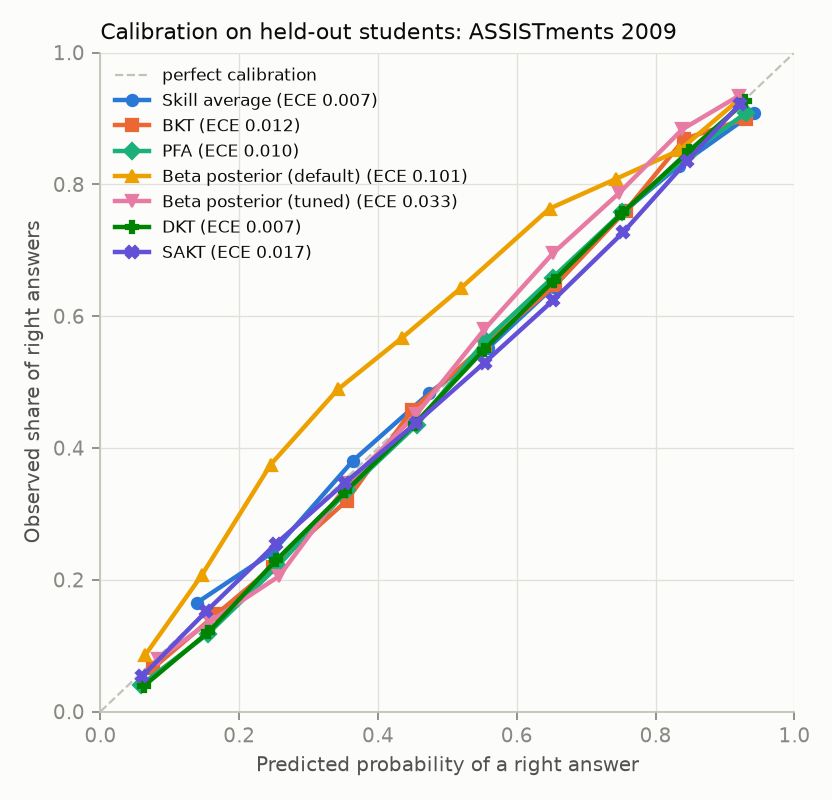

# kt-bench

[](https://github.com/Janik10/kt-bench/actions/workflows/ci.yml)

Knowledge tracing predicts whether a student will answer their next question
correctly from the answers they have already given. This repo asks how much
neural models (DKT, SAKT) beat classic ones (BKT, PFA, a Beta-posterior counting
model) on public data, under one leakage-checked protocol and especially for
students with very little history.

## Results

<!-- results:start -->
**ASSISTments 2009: 5 draws of the 20% test students**, config defaults, mean ± std over draws

| Model | AUC | pyKT published AUC (ours − pyKT) | Accuracy | Brier | ECE | AUC, 1–5 prior answers | Draws |
|---|---|---|---|---|---|---|---|
| Skill average | 0.6224 ± 0.0042 | – | 0.6674 ± 0.0046 | 0.2145 ± 0.0019 | 0.0113 ± 0.0033 | 0.6335 ± 0.0127 | 5 |
| BKT | 0.7217 ± 0.0040 | – | 0.7177 ± 0.0048 | 0.1912 ± 0.0021 | 0.0118 ± 0.0024 | 0.7367 ± 0.0073 | 5 |
| PFA | 0.7087 ± 0.0039 | – | 0.7037 ± 0.0049 | 0.1967 ± 0.0021 | 0.0215 ± 0.0022 | 0.7098 ± 0.0081 | 5 |
| Beta posterior (Beta(1, 1) prior) | 0.7024 ± 0.0052 | – | 0.6899 ± 0.0063 | 0.2086 ± 0.0022 | 0.1049 ± 0.0018 | 0.7118 ± 0.0072 | 5 |
| Beta posterior (skill-centred prior) | 0.7103 ± 0.0045 | – | 0.7026 ± 0.0055 | 0.1965 ± 0.0022 | 0.0483 ± 0.0035 | 0.7249 ± 0.0063 | 5 |
| DKT | 0.7575 ± 0.0045 | 0.7541 (+0.0034) | 0.7336 ± 0.0058 | 0.1802 ± 0.0025 | 0.0073 ± 0.0036 | 0.7639 ± 0.0083 | 5 |
| SAKT | 0.7359 ± 0.0042 | 0.7246 (+0.0113) | 0.7188 ± 0.0064 | 0.1878 ± 0.0028 | 0.0230 ± 0.0044 | 0.7520 ± 0.0100 | 5 |

**ASSISTments 2009: fixed seed-42 test set**, tuned params, mean ± std over 5 training seeds

The fixed seed-42 test set is +0.0059 AUC easier than an average draw (mean over 7 models, same default params), so read the table below as a within-split comparison, not an estimate of absolute AUC.

| Model | AUC | pyKT published AUC (ours − pyKT) | Accuracy | Brier | ECE | AUC, 1–5 prior answers | Train (s, median) | Inference (µs/answer) | Runs |
|---|---|---|---|---|---|---|---|---|---|
| Skill average | 0.6214 ± 0.0004 | – | 0.6592 ± 0.0007 | 0.2171 ± 0.0001 | 0.0080 ± 0.0023 | 0.6386 ± 0.0020 | 0.3 | 1.6 | 5 |
| BKT | 0.7344 ± 0.0006 | – | 0.7200 ± 0.0005 | 0.1894 ± 0.0002 | 0.0124 ± 0.0007 | 0.7372 ± 0.0006 | 136.5 | 10.7 | 5 |
| PFA | 0.7323 ± 0.0005 | – | 0.7161 ± 0.0007 | 0.1904 ± 0.0002 | 0.0101 ± 0.0010 | 0.7377 ± 0.0008 | 2.0 | 2.3 | 5 |
| Beta posterior (default) | 0.7108 ± 0.0000 | – | 0.6927 ± 0.0000 | 0.2074 ± 0.0000 | 0.1010 ± 0.0000 | 0.7102 ± 0.0000 | 0.0 | 2.1 | 5 |
| Beta posterior (tuned) | 0.7152 ± 0.0002 | – | 0.7048 ± 0.0005 | 0.1969 ± 0.0001 | 0.0330 ± 0.0015 | 0.7170 ± 0.0007 | 0.2 | 2.1 | 5 |
| DKT | 0.7638 ± 0.0006 | 0.7541 (+0.0097) | 0.7340 ± 0.0007 | 0.1799 ± 0.0003 | 0.0087 ± 0.0015 | 0.7648 ± 0.0020 | 45.2 | 5.5 | 5 |
| SAKT | 0.7477 ± 0.0005 | 0.7246 (+0.0231) | 0.7227 ± 0.0012 | 0.1853 ± 0.0004 | 0.0180 ± 0.0075 | 0.7526 ± 0.0022 | 200.8 | 6.4 | 5 |

**EdNet KT1 (sample)**, held-out test students, mean ± std over 5 training seeds

| Model | AUC | pyKT published AUC (ours − pyKT) | Accuracy | Brier | ECE | AUC, 1–5 prior answers | Train (s, median) | Inference (µs/answer) | Runs |
|---|---|---|---|---|---|---|---|---|---|
| Skill average | 0.5905 ± 0.0002 | – | 0.6523 ± 0.0000 | 0.2221 ± 0.0000 | 0.0110 ± 0.0011 | 0.5864 ± 0.0006 | 10.1 | 2.3 | 5 |
| BKT | 0.6495 ± 0.0001 | – | 0.6674 ± 0.0001 | 0.2131 ± 0.0000 | 0.0157 ± 0.0003 | 0.6104 ± 0.0009 | 3639.3 | 9.5 | 5 |
| PFA | 0.6517 ± 0.0002 | – | 0.6656 ± 0.0001 | 0.2123 ± 0.0000 | 0.0039 ± 0.0004 | 0.6054 ± 0.0006 | 91.0 | 3.1 | 5 |
| Beta posterior (default) | 0.6332 ± 0.0000 | – | 0.6454 ± 0.0000 | 0.2199 ± 0.0000 | 0.0462 ± 0.0000 | 0.5402 ± 0.0000 | 0.0 | 6.3 | 5 |
| Beta posterior (tuned) | 0.6412 ± 0.0002 | – | 0.6578 ± 0.0000 | 0.2151 ± 0.0000 | 0.0192 ± 0.0003 | 0.5902 ± 0.0008 | 9.5 | 6.9 | 5 |
| DKT | 0.6776 ± 0.0002 | – | 0.6818 ± 0.0002 | 0.2063 ± 0.0001 | 0.0099 ± 0.0053 | 0.6435 ± 0.0011 | 419.4 | 7.4 | 5 |
| SAKT | 0.6674 ± 0.0009 | – | 0.6805 ± 0.0007 | 0.2089 ± 0.0006 | 0.0260 ± 0.0073 | 0.6439 ± 0.0036 | 672.0 | 8.5 | 5 |
<!-- results:end -->

All numbers are on held-out **students** (never seen in training), with one
prediction per question, so multi-skill questions are scored once. The headline
table averages over five different draws of the test students; the fixed-split
tables average five training seeds on one test set, so their ± only reflects
training randomness. "AUC, 1–5 prior answers" is the cold-start slice: answers
where the student had given only 1–5 answers before.



More figures (AUC by prior answers, training time vs. AUC, EdNet calibration) are
in [report/figures/](report/figures/), and the write-up is in [report/](report/).

## Models

All six sit behind one interface: `fit(train, valid)` and `predict(df) -> P(correct)`,
where each prediction may only use that student's earlier answers. One scorer
(`ktbench.evaluate`) scores them all.

| # | Model | What it is | Code |
|---|---|---|---|
| 0 | Skill average | Each skill's overall correct rate; the floor | [skill_avg.py](src/ktbench/models/skill_avg.py) |
| 1 | BKT | Hidden known/unknown state per skill, fit by EM | [bkt.py](src/ktbench/models/bkt.py) |
| 2 | PFA | Logistic regression on per-skill prior successes/failures | [pfa.py](src/ktbench/models/pfa.py) |
| 3 | Beta posterior | Per-skill Beta(α, β) counts of right/wrong answers with a decaying half-life | [beta.py](src/ktbench/models/beta.py) |
| 4 | DKT | LSTM over the answer history, written from scratch | [dkt.py](src/ktbench/models/dkt.py) |
| 5 | SAKT | Self-attention over past answers, written from scratch | [sakt.py](src/ktbench/models/sakt.py) |

The Beta-posterior baseline is reported twice: with untuned defaults (Beta(1, 1)
prior), and with the prior and evidence half-life tuned on the validation fold.

## Protocol

Follows [pyKT](https://arxiv.org/abs/2206.11460) so the numbers compare with published ones.

- **Splits by student.** 20% of students are the test set; the other 80% are split
  into 5 folds. Hyperparameters and early stopping only ever see the validation fold.
- **One-step-ahead.** Predict answer t+1 from answers 1..t. Each student's first
  answer is not scored.
- **Question-level, no label leakage.** Skill-level models (BKT, DKT, SAKT) score
  every skill of a question from the state *before* the question and average them.
  The second skill of a question never sees the answer to the first: sequence
  models carry a per-token `ctx` index that enforces this (see
  [sequences.py](src/ktbench/data/sequences.py)).
- **Tuning on validation only.** Random search over each model's `search:` block,
  scored on validation fold 0; every model gets the same number of trials
  (`TRIALS`, default 12), capped by the size of its grid.

Reference AUCs on ASSISTments 2009 (pyKT paper): DKT 0.7541, SAKT 0.7246, AKT 0.7853.

## Tests that guard the protocol

| Test | What it catches |
|---|---|
| [test_splits.py](tests/test_splits.py) | A test student appearing in train or validation |
| [test_causality.py](tests/test_causality.py) | A prediction moving when that student's current or future answers change, including the multi-skill leak |
| [test_determinism.py](tests/test_determinism.py) | The same seed giving a different AUC (4 decimal places) |
| [test_padding.py](tests/test_padding.py) | Padded positions affecting predictions, the loss or the metrics |

CI runs lint, the tests and an end-to-end run on a small synthetic dataset on every push.

## Reproduce

```bash
python -m venv .venv && source .venv/bin/activate     # Python 3.11
pip install torch --index-url https://download.pytorch.org/whl/cu126   # or /whl/cpu
pip install -e ".[dev]"
bash scripts/reproduce_all.sh                # one command: downloads ASSISTments 2009, trains every model,
                                             # runs the 5-draw split study, prints the tables, draws the figures
python -m ktbench.report --readme            # writes the tables above
```

EdNet (about 1.2 GB download, then several GPU hours):

```bash
python -m ktbench.data.ednet --sample 50000  # downloads KT1 + Contents, builds the 50k-student sample
bash scripts/reproduce_all.sh ednet
```

One model, one run, with a quick override:

```bash
python -m ktbench.train configs/assist2009/dkt.yaml --runs 0 --set max_epochs=5
python -m ktbench.tune  configs/assist2009/pfa.yaml --trials 12
```

ASSISTments 2009 trains on a laptop CPU; DKT and SAKT use a GPU when one is available.

## Data

Datasets are downloaded by the code into `data/` (git-ignored) and never committed.
If Google Drive refuses the scripted download, fetch the files by hand and put them
at the paths the error message prints.

- **ASSISTments 2009–2010 Skill Builder**, the *corrected, collapsed* release (the
  original has duplicate rows). The raw file matches pyKT's statistics (4,217 students,
  346,860 rows, 26,688 questions, 123 skills); after pyKT's cleaning (drop rows with no skill,
  drop students with fewer than 3 answers) it is 3,852 students, 282,619 interactions,
  17,737 questions, 123 skills.
  Source: [ASSISTments data page](https://sites.google.com/site/assistmentsdata/home/2009-2010-assistment-data/skill-builder-data-2009-2010).
  Please cite the dataset and the ASSISTments paper if you use it.
- **EdNet KT1** ([repository](https://github.com/riiid/ednet)), CC BY-NC 4.0, research and
  non-commercial use only: do not use models trained on it in a commercial product.
  `python -m ktbench.data.ednet` downloads `EdNet-KT1.zip` and `EdNet-Contents.zip`
  ([bit.ly/ednet_kt1](http://bit.ly/ednet_kt1), [bit.ly/ednet-content](http://bit.ly/ednet-content)),
  joins answers to the correct letter and tags, and writes a 50,000-student sample
  (46,951 students after cleaning, 6,118,335 answers, 12,264 questions, 188 tags).

## Layout

```
configs/<dataset>/<model>.yaml   one config per model x dataset
src/ktbench/data/                download, clean, split, Parquet, sequence windows
src/ktbench/models/              the six models behind one interface
src/ktbench/train.py             trains + tests any config
src/ktbench/tune.py              validation-only random search
src/ktbench/evaluate.py          the one scorer
src/ktbench/analysis/            cold-start buckets, split study, figures
src/ktbench/demo.py              predicted mastery for an answer history, from a saved model
results/                         per-run JSON (committed); predictions and models go to runs/ (ignored)
report/                          write-up (report.md, build_pdf.py) and figures
```

## Demo

```bash
python -m ktbench.demo runs/assist2009/dkt/model_run0.pkl --history "10:1 10:0 45+10:1 45:0"
```

Prints the predicted chance of a right answer on each skill after every answer
(`skill:correct`, `+` joins the skills of one question).

## License and citations

Code: MIT (see [LICENSE](LICENSE)). The datasets keep their own terms. If you use
them, cite their authors:

```bibtex
@article{feng2009assistments,
  title   = {Addressing the assessment challenge with an online system that tutors as it assesses},
  author  = {Feng, Mingyu and Heffernan, Neil and Koedinger, Kenneth},
  journal = {User Modeling and User-Adapted Interaction},
  volume  = {19}, number = {3}, pages = {243--266}, year = {2009}
}
@article{choi2019ednet,
  title   = {EdNet: A Large-Scale Hierarchical Dataset in Education},
  author  = {Choi and Lee and Shin and Cho and Park and Lee and Baek and Bae and Kim and Heo},
  journal = {arXiv preprint arXiv:1912.03072}, year = {2019}
}
@inproceedings{liu2022pykt,
  title     = {pyKT: A Python Library to Benchmark Deep Learning based Knowledge Tracing Models},
  author    = {Liu, Zitao and Liu, Qiongqiong and Chen, Jiahao and Huang, Shuyan and Tang, Jiliang and Luo, Weiqi},
  booktitle = {NeurIPS Datasets and Benchmarks Track}, year = {2022}
}
```

The ASSISTments maintainers ask to be told about papers that use the data.
