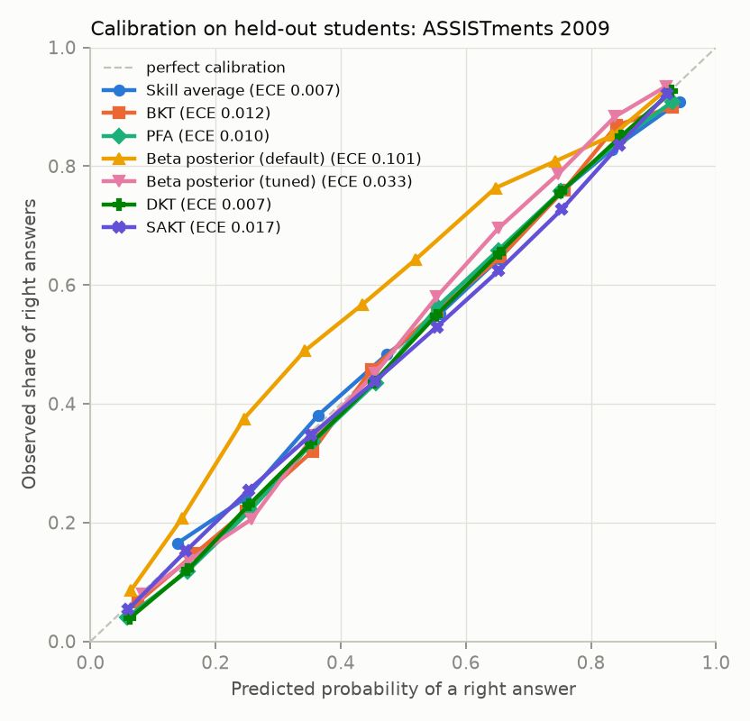
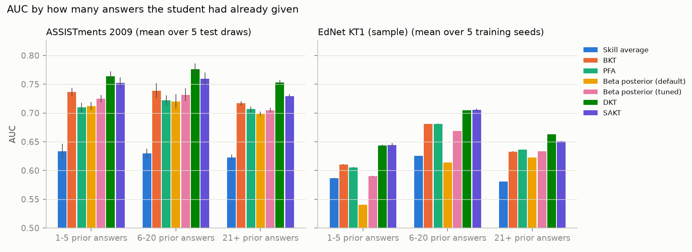
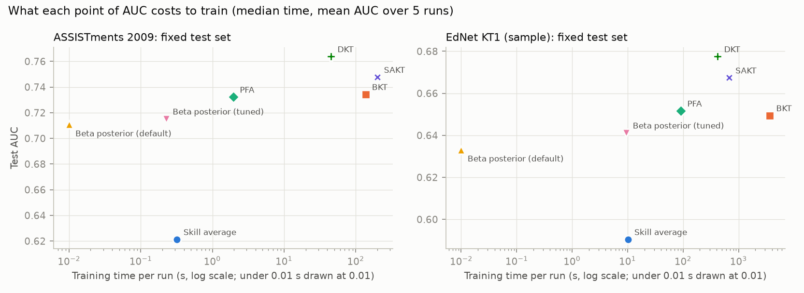

## Abstract

Knowledge tracing predicts whether a student will answer their next question
correctly from the answers they have already given. We re-implement six
models behind one interface: a per-skill average, Bayesian Knowledge Tracing
(BKT), Performance Factors Analysis (PFA), a Bayesian Beta-posterior counting
model, Deep Knowledge Tracing (DKT) and Self-Attentive Knowledge Tracing
(SAKT). We evaluate them under one protocol on ASSISTments 2009 and a
50,000-student sample of EdNet KT1. The protocol follows pyKT: student-level
splits, one prediction per question, and multi-skill questions predicted
"all-in-one" so no skill sees the answer to another skill of the same
question. Tests enforce this, along with causality, determinism and padding.
On ASSISTments 2009, averaged over five draws of the held-out students, DKT
reaches 0.7575 ± 0.0045 AUC (pyKT reports 0.7541) and SAKT 0.7359 ± 0.0042
(pyKT: 0.7246). The best classic model, BKT, reaches 0.7217 ± 0.0040. DKT's
lead holds for students with only 1–5 prior answers. On EdNet the ordering is
the same and the gaps are larger [CHECK: fill with tuned EdNet numbers]. An
untuned Beta-posterior baseline is competitive on ranking (0.7024 AUC) but
poorly calibrated (ECE 0.105); a tuned prior halves the calibration error.

## 1. Introduction

*Outline only; to be written by the author.*

- The task: predict the next answer from the answer history; what it is used for (mastery estimates shown to instructors, choosing what to practise next).
- The gap: published numbers depend on protocol details (row vs. student splits, KC- vs. question-level scoring, label leakage), and small deployments need to know whether a neural model is worth it.
- What this work does: one interface, one scorer, leakage tests, five-draw uncertainty, a cold-start breakdown, cost vs. accuracy.
- Contributions (3 bullets): reproduction within ~0.003 AUC for DKT; a cold-start analysis; an open, one-command benchmark with CI-tested protocol guards.

## 2. Related Work

**Bayesian Knowledge Tracing.** Corbett and Anderson [1] model each skill as a
two-state hidden Markov model (known / not known) with learn, guess and slip
probabilities; the parameters are usually fit by EM. pyBKT [2] is the common
open implementation.

**Performance Factors Analysis.** Pavlik, Cen and Koedinger [3] replace the
hidden state with a logistic regression on each student's prior successes and
failures per skill, which handles multi-skill items naturally.

**Deep Knowledge Tracing.** Piech et al. [4] feed the answer history to an
LSTM and read off a probability per skill. Later work questioned how much of
the original gain was real [5, 6] and showed DKT's predictions can move in the
wrong direction after a correct answer [7].

**Self-attention.** SAKT [8] replaces the recurrence with attention from the
skill being asked over embeddings of past answers; AKT [9] adds monotonic
attention and Rasch-style item embeddings.

**Benchmarks and protocol.** pyKT [10] standardised preprocessing, student-level
splits and question-level evaluation, and showed that "one-by-one" evaluation
of expanded multi-skill sequences leaks labels and inflates AUC (DKT on
ASSISTments 2009: 0.8262 one-by-one vs. 0.7541 question-level all-in-one).

**Do we need to go deep?** Gervet et al. [11] and Mandalapu et al. [12]
[CHECK: confirm authors and venue of "Do we need to go deep? Knowledge tracing
with big data"] report that well-featured logistic regression models can
match deep models, especially on smaller datasets.

## 3. Data

**ASSISTments 2009–2010 Skill Builder** [13], corrected and collapsed release.
The raw file matches pyKT's Table 1 exactly (4,217 students; 346,860 rows;
26,688 questions; 123 skills). Cleaning follows pyKT: drop the 63,755 rows
with no skill tag (no other field is missing and every response is 0/1), then
drop students with fewer than 3 answers (486 rows). This leaves 3,852
students, 282,619 question-level answers, 17,737 questions and 123 skills, or
337,424 skill-level rows. pyKT reports 337,415 skill-level rows. The 9-row
difference is exactly pyKT's additional rule of dropping 200-token windows
shorter than 3 tokens (5 students with 201, 202 or 602 skill-level rows). We
keep and score those rows. ASSISTments 2009 has no timestamps; answers are
ordered by `order_id`.

**EdNet KT1** [14] holds one CSV per student with the letter chosen, not
right/wrong. We join each answer to the question's correct letter and tags
from the Contents release, read the CSVs directly from the zip in parallel,
and write Parquet. We use a random sample of 50,000 students (seed 0); after
dropping students with fewer than 3 answers and questions without tags, it has
46,951 students, 6,118,335 answers, 12,264 questions and 188 skill tags.
Answers are ordered by timestamp.

## 4. Methods

All models implement `fit(train, valid)` and `predict(df)`. `predict` returns,
for every row, P(correct) using only that student's earlier rows, and a single
scorer evaluates every model.

- **Skill average.** Each skill's training-set correct rate, lightly smoothed;
  multi-skill questions average their skills. A floor.
- **BKT.** Per-skill two-state HMM (prior, learn, guess, slip, optional
  forget), fit by Baum–Welch with random restarts; prediction is forward
  filtering. Implemented here because pyBKT 1.4.3 does not run under numpy 2
  and current scikit-learn. Sequences are padded in length-sorted chunks so
  that EdNet fits in memory.
- **PFA.** Logistic regression on per-skill intercepts and per-skill prior
  success and failure counts (raw or log1p).
- **Beta posterior.** Per student and skill, a Beta(α, β) posterior; every
  answer adds a recency-weighted count to α (right) or β (wrong), with weight
  2^(−age / half-life), and the posterior mean is the prediction. The
  *default* variant uses a Beta(1, 1) prior and no tuning (on EdNet, a
  23.1-day half-life; on ASSISTments, no decay). The *tuned* variant also
  chooses a skill-centred prior strength and the half-life.
- **DKT.** Embedding of (skill, right/wrong), one-layer LSTM, a linear map to
  one logit per skill; the logit of the skill asked is the prediction.
- **SAKT.** Queries are embeddings of the skill asked; keys and values are
  embeddings of past (skill, right/wrong) answers plus position; multi-head
  attention with a causal mask, residual connections, layer norm and a
  feed-forward block.

**Multi-skill questions (leakage guard).** Sequence models read one token per
(question, skill). Each token carries `ctx`, the position where its question
starts. DKT reads the LSTM state at `ctx`. SAKT may attend only to positions
up to `ctx`, using a shifted sequence with a beginning-of-sequence token so
every position has at least one key. All skills of a question are therefore
predicted from the same pre-question state ("all-in-one"), and their
probabilities are averaged into one question-level prediction (late fusion,
mean).

## 5. Evaluation Protocol

- **Splits by student.** 20% of students form the test set; the other 80% are
  split into 5 folds. Run *r* trains on four folds, early-stops and tunes on
  fold *r*, and is scored on the test students.
- **Task and unit.** One-step-ahead prediction, one prediction per question;
  each student's first answer is not scored (as in pyKT). On ASSISTments a test
  set has 59,446 scored answers.
- **Metrics.** AUC (headline), accuracy at 0.5, Brier score, expected
  calibration error (10 equal-width bins), and AUC by number of prior answers
  (1–5, 6–20, 21+).
- **Uncertainty.** Repeating training seeds on one fixed test set gives tiny
  standard deviations (≤ 0.0006 AUC) that understate the real uncertainty. The
  headline ASSISTments table therefore averages over five different draws of
  the test students (split seeds 0–4) with each model's default settings.
- **Tuning.** Random search over each model's grid, scored on validation fold
  0 only. Test students are never loaded during tuning.
- **Guards, run in CI.** No test student appears in train or validation;
  changing a student's current or future answers never changes an earlier
  prediction (including the multi-skill case); the same seed gives the same
  AUC to four decimals; padded positions never affect predictions or the loss.

## 6. Results

**Table 1. ASSISTments 2009, five draws of the test students** (default
settings; mean ± std over draws).

| Model | AUC | pyKT AUC (ours − pyKT) | Brier | ECE | AUC, 1–5 prior answers |
|---|---|---|---|---|---|
| Skill average | 0.6224 ± 0.0042 | – | 0.2145 | 0.0113 | 0.6335 |
| BKT | 0.7217 ± 0.0040 | – | 0.1912 | 0.0118 | 0.7367 |
| PFA | 0.7087 ± 0.0039 | – | 0.1967 | 0.0215 | 0.7098 |
| Beta posterior (default) | 0.7024 ± 0.0052 | – | 0.2086 | 0.1049 | 0.7118 |
| Beta posterior (tuned) | 0.7103 ± 0.0045 | – | 0.1965 | 0.0483 | 0.7249 |
| DKT | **0.7575 ± 0.0045** | 0.7541 (+0.0034) | **0.1802** | **0.0073** | **0.7639** |
| SAKT | 0.7359 ± 0.0042 | 0.7246 (+0.0113) | 0.1878 | 0.0230 | 0.7520 |

*In Table 1, "tuned" for the Beta posterior means its config defaults (a
skill-centred prior with a 10-answer half-life), not a per-draw search.
[CHECK: rename the row or rerun with the tuned params before release.]*

**Table 2. ASSISTments 2009, fixed seed-42 test set, tuned settings** (mean ±
std over 5 training seeds). With the same default settings, the seed-42 test set
is 0.0059 AUC easier than an average of the five draws (mean over all seven
models), so these numbers sit slightly above Table 1.

| Model | AUC | Accuracy | ECE | Train (s) | Inference (µs/answer) |
|---|---|---|---|---|---|
| Skill average | 0.6214 ± 0.0004 | 0.6592 | 0.0080 | 0.3 | 1.6 |
| BKT | 0.7346 ± 0.0005 | 0.7198 | 0.0115 | 28 [CHECK] | 11.5 |
| PFA | 0.7323 ± 0.0005 | 0.7161 | 0.0101 | 1.5 | 1.7 |
| Beta posterior (default) | 0.7108 ± 0.0000 | 0.6927 | 0.1010 | < 0.1 | 2.1 |
| Beta posterior (tuned) | 0.7152 ± 0.0002 | 0.7048 | 0.0330 | 0.2 | 2.1 |
| DKT | 0.7638 ± 0.0006 | 0.7340 | 0.0087 | 43 | 5.5 |
| SAKT | 0.7477 ± 0.0005 | 0.7227 | 0.0180 | 196 | 6.4 |

**Table 3. EdNet KT1, 50,000-student sample, fixed test set** (9,390 test
students; 1,220,901 scored answers). [CHECK: replace with the tuned numbers
from the overnight run; current values use default settings for BKT, DKT and
SAKT.]

| Model | AUC | ECE | AUC, 1–5 prior answers | Train (s) |
|---|---|---|---|---|
| Skill average | 0.5905 ± 0.0002 | 0.0110 | 0.5864 | 11 |
| BKT | [CHECK] | [CHECK] | [CHECK] | [CHECK] |
| PFA | 0.6517 ± 0.0002 [CHECK] | 0.0040 | 0.6056 | 85 |
| Beta posterior (default) | 0.6332 ± 0.0000 | 0.0462 | 0.5402 | < 0.1 |
| Beta posterior (tuned) | 0.6412 ± 0.0002 | 0.0192 | 0.5902 | 9 |
| DKT | 0.6774 ± 0.0001 [CHECK] | 0.0064 | 0.6431 | 339 |
| SAKT | 0.6687 ± 0.0004 | 0.0113 | 0.6472 | 815 |

**Observations.**

1. *Reproduction.* Over five test draws, DKT is within 0.0034 AUC of pyKT and
   SAKT is 0.0113 above it, just outside the 0.01 target.
2. *Neural vs. classic.* DKT beats the best classic model by about 0.036 AUC
   on ASSISTments (0.7575 vs. 0.7217 for BKT, five draws) and by about 0.026
   on EdNet (0.6774 vs. 0.6517 for PFA) [CHECK: EdNet after tuning].
3. *Cold start.* For answers with only 1–5 prior answers, DKT still leads on
   ASSISTments (0.7639 vs. 0.7367 for BKT). On EdNet both neural models are far
   ahead of the counting models (DKT 0.6431, SAKT 0.6472, Beta default
   0.5402).
4. *Calibration.* All models except the default Beta posterior have ECE
   ≤ 0.023. The default Beta(1, 1) prior is badly calibrated on ASSISTments
   (ECE 0.10): it starts every skill at 0.5 while the base rate is about 0.66.
   A skill-centred prior cuts ECE to 0.033–0.048.
5. *Cost.* The Beta posterior trains in under a second and PFA in 1.5 s; DKT
   costs about 43 s per run on ASSISTments and SAKT about 196 s on a laptop
   GPU, for the largest accuracy gains. Inference is a few microseconds per
   answer for all models.

## 7. Discussion

*Outline only; to be written by the author.*

- What the size of the DKT–BKT gap means in practice; whether 0.036 AUC changes decisions.
- Why counting models struggle at cold start on EdNet but not on ASSISTments (skill granularity, 188 tags vs. 123 skills, timestamps).
- Calibration matters more than AUC when probabilities are shown to people; the prior is the cheapest fix.
- DKT's inconsistent updates (mastery of one skill drops after answering another) seen in the demo; link to [7].
- When a simple model is the right choice: tiny data, interpretability, cost.

## 8. Limitations

- **Default vs. tuned settings.** Table 1 uses each model's config defaults on
  every draw, while Table 2 uses settings tuned on validation fold 0 of the
  seed-42 split. On EdNet, BKT and SAKT were not tuned with the full 12-trial
  budget because it exceeds four hours [CHECK: final status after the
  overnight run]. On ASSISTments, BKT received 4 trials and PFA 8, because
  their search grids had only that many points; the other models received 12.
- **SAKT is 0.011 AUC above pyKT.** Possible causes: our all-in-one attention
  mask is also used in training; test-time windows overlap by half (each
  scored answer has at least 100 tokens of context) instead of being cut
  independently; different hyperparameters. Not yet isolated.
- **Fixed test set is easier than average.** Seed 42 is 0.0059 AUC easier
  than an average draw, which inflates Table 2 relative to Table 1.
- **EdNet sample.** Results use a 50,000-student random sample, not the full
  784,309 students.
- **EdNet license.** EdNet is CC BY-NC 4.0: research and non-commercial use
  only. Models trained on it must not ship in a commercial product.
- **No real course data.** No data from a live course or deployment was
  evaluated; all results are on public benchmarks.
- **Timing.** Training times come from single runs on one laptop (RTX 4060
  laptop GPU, 12 CPU threads). Some ASSISTments runs overlapped with other jobs,
  so times are indicative only [CHECK].
- **Scope.** No AKT or other newer attention models; no item (question-ID)
  embeddings in any model.

## 9. Future Work

- Add AKT and simpleKT, the strongest models in the pyKT benchmark.
- Isolate the SAKT gap: rerun with pyKT's non-overlapping test windows and its training mask.
- Full EdNet (784k students) on a larger GPU.
- Equal tuning budgets for every model on both datasets, and per-draw tuning for the five-draw table.
- Item-level features (question IDs) for PFA and the neural models.
- Evaluate on small real-world course data with a within-student temporal split and bootstrap intervals.

## References

[1] A. T. Corbett and J. R. Anderson. Knowledge tracing: Modeling the acquisition of procedural knowledge. *User Modeling and User-Adapted Interaction*, 4(4):253–278, 1995.

[2] A. Badrinath, F. Wang and Z. Pardos. pyBKT: An accessible Python library of Bayesian Knowledge Tracing models. *EDM*, 2021. [CHECK]

[3] P. I. Pavlik Jr., H. Cen and K. R. Koedinger. Performance Factors Analysis – A new alternative to knowledge tracing. *AIED*, 2009.

[4] C. Piech, J. Bassen, J. Huang, S. Ganguli, M. Sahami, L. Guibas and J. Sohl-Dickstein. Deep knowledge tracing. *NeurIPS*, 2015.

[5] M. Khajah, R. V. Lindsey and M. C. Mozer. How deep is knowledge tracing? *EDM*, 2016.

[6] X. Xiong, S. Zhao, E. G. Van Inwegen and J. E. Beck. Going deeper with deep knowledge tracing. *EDM*, 2016. [CHECK]

[7] C.-K. Yeung and D.-Y. Yeung. Addressing two problems in deep knowledge tracing via prediction-consistent regularization. *L@S*, 2018.

[8] S. Pandey and G. Karypis. A self-attentive model for knowledge tracing. *EDM*, 2019.

[9] A. Ghosh, N. Heffernan and A. S. Lan. Context-aware attentive knowledge tracing. *KDD*, 2020.

[10] Z. Liu, Q. Liu, J. Chen, S. Huang, J. Tang and W. Luo. pyKT: A Python library to benchmark deep learning based knowledge tracing models. *NeurIPS Datasets and Benchmarks*, 2022. arXiv:2206.11460.

[11] T. Gervet, K. Koedinger, J. Schneider and T. Mitchell. When is deep learning the best approach to knowledge tracing? *Journal of Educational Data Mining*, 12(3), 2020. [CHECK]

[12] V. Mandalapu, J. Gong and L. Chen. Do we need to go deep? Knowledge tracing with big data. arXiv:2101.08349, 2021. [CHECK]

[13] M. Feng, N. Heffernan and K. Koedinger. Addressing the assessment challenge with an online system that tutors as it assesses. *User Modeling and User-Adapted Interaction*, 19(3):243–266, 2009.

[14] Y. Choi, Y. Lee, D. Shin, J. Cho, S. Park, S. Lee, J. Baek, C. Bae, B. Kim and J. Heo. EdNet: A large-scale hierarchical dataset in education. *AIED*, 2020.
